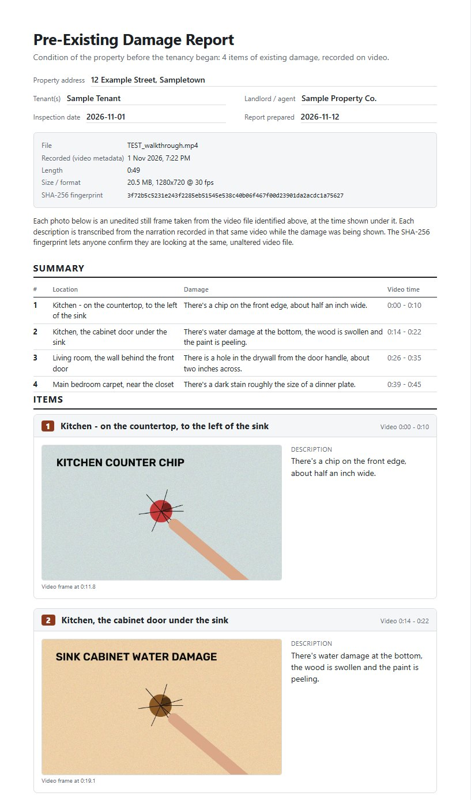

# Video Damage Report

Turn a narrated walkthrough video of a rental into a **pre-existing damage report**: one photo per damage spot,
**your own words** as the description, and the time in the video each one comes from.

You film the property, point at each bit of damage and say where it is and what it is. This tool does the rest,
**entirely on your own computer**. Nothing is uploaded.

> General AI chat tools tend to fail at this in one of two ways. Some ignore your narration and write their own
> descriptions of whatever looks like damage. Others transcribe you but can't pull the matching frames out of the video.
> This tool ties the two together with timestamps: what you said, and the moment you said it, decide which frames to use.



Full sample: [docs/sample-report.pdf](docs/sample-report.pdf), made from a synthetic test video with a computer voice.

## How it works

1. **Listen.** [faster-whisper](https://github.com/SYSTRAN/faster-whisper) transcribes the narration on your machine,
   with a timestamp for every word.
2. **Split.** The narration is broken into one item per damage spot (location, description, time window), using the
   pauses between spots. The result is a plain-text `items.json` you can edit.
3. **Photograph.** For each item, only that time window of the video is scanned. The 8 sharpest frames are kept as
   candidates, the sharpest is auto-picked, and a contact sheet shows all 8 so you can choose a different one.
4. **Assemble.** An HTML report is built and printed to PDF with headless Edge or Chrome. It contains:
   - property fields and the video's details, including its **SHA-256 fingerprint**
   - a summary table
   - one card per item: photo, location, description, video time
   - signature lines
   - the full timestamped transcript as an appendix

The photos are unedited frames from the video, each labelled with its time. The fingerprint lets anyone confirm the
report was made from that exact, unaltered file.

## Quick start (Windows)

1. Install [Python 3.10+](https://www.python.org/downloads/).
2. Download this repo (green **Code** button → *Download ZIP*) and unzip it, or `git clone` it.
3. Copy your walkthrough video into the folder and **drag it onto `Make Damage Report.bat`**.
   - The first run installs the dependencies into `%USERPROFILE%\.damage-report\venv` and downloads the Whisper
     speech model (about 1.5 GB, one time only).
   - A 10-minute video takes roughly 5-15 minutes on a typical laptop.
4. The PDF opens when it's done: `<video name> - damage report\Damage Report.pdf`.

### macOS / Linux (should work, untested)

```bash
python3 -m venv ~/.damage-report/venv
~/.damage-report/venv/bin/pip install -r requirements.txt
~/.damage-report/venv/bin/python tool/damage_report.py all "my walkthrough.mp4"
```

The PDF step needs Chrome, Edge or Chromium. Without one, open the HTML report and use Print → Save as PDF.

## Fixing the result

Everything in the report comes from `items.json` in the output folder:

```json
{
  "id": 3,
  "location": "Living room - wall behind the front door",
  "description": "There is a hole in the drywall from the door handle, about two inches across.",
  "start": 26.5, "end": 35.9,
  "photos": ["c4"],
  "exclude": false
}
```

| To fix | Do this |
|---|---|
| Wording or location | Edit `location` / `description`. |
| Not a damage item (e.g. "okay, moving to the bedroom") | Set `"exclude": true`. |
| Wrong photo | Open `frames/item_03/contact.jpg` and put the candidate you want in `"photos": ["c6"]`. Two is fine: `["c2", "c6"]`. |
| No good candidate | `grab` a frame at an exact time (see below). |
| Address and names | Fill in `"info"` near the top: `property`, `tenant`, `landlord`, `inspection_date`. |

Then rebuild: drag the `... - damage report` folder onto `Make Damage Report.bat`, or run the `report` command.

## Commands

```
python tool/damage_report.py all        VIDEO                  # everything in one go
python tool/damage_report.py transcribe VIDEO                  # transcript + draft items.json
python tool/damage_report.py overview   WORKDIR                # one frame per second of the whole video
python tool/damage_report.py frames     WORKDIR [--redo|--only 3,7]
python tool/damage_report.py grab       WORKDIR --item 3 2:14  # sharpest frame within 0.4 s of 2:14
python tool/damage_report.py report     WORKDIR [--property ...] [--tenant ...] [--landlord ...] [--paper A4|Letter]
```

Useful options:
- `--model small.en` transcribes faster; `--model large-v3` is the most accurate but slow.
- `--gap 2.0` sets how many seconds of silence start a new item.
- `--pre` / `--post` control how far before and after your narration to look for frames.

## Recording tips

- For each spot: **point, hold still for about 2 seconds, then talk**. Frames are only as sharp as the camera.
- Say the **location first**, then the damage: *"Kitchen, left of the sink. There's a chip in the countertop edge."*
- **Pause for 2+ seconds** (or walk) between spots. That's how the automatic split finds them.
- Use good light. Turn the phone's flashlight on for dark corners and inside cabinets.
- Keep the **original file**. Copies sent through WhatsApp or Messenger are heavily compressed and lose the recording date.

## Optional: let Claude Code do the review

[`CLAUDE.md`](CLAUDE.md) describes a review procedure for [Claude Code](https://claude.com/claude-code). Open it in this
folder and say *"make the damage report for <video>"*. Claude will:

- re-split the narration properly
- use the overview image to see when each spot is on camera, since people often point before or after speaking
- look at every contact sheet to pick the frame showing the damage
- rebuild and check the PDF

It keeps your words and doesn't add details you didn't say. The review costs tokens, mostly for the images. A
mid-sized model handles it well. To spend less, run the `.bat` first and only ask Claude to fix specific items.

## Notes and limits

- The auto-pick is just the **sharpest** frame in each item's window, and it can be the wrong spot. Check the contact sheets.
- The automatic split relies on pauses. A single run-on sentence covering several spots needs splitting by hand (or by Claude).
- Whisper can mishear words. The appendix transcript is there so anyone can cross-check it against the video.
- This makes documentation, not legal advice. Check what your local tenancy rules expect from a condition report.
- Developed and tested on Windows 11 with Python 3.12.

## License

[MIT](LICENSE)
